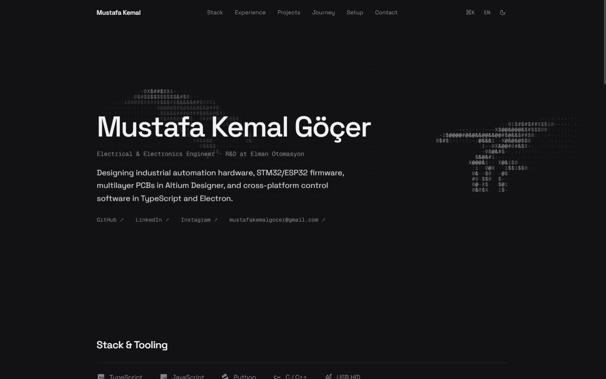
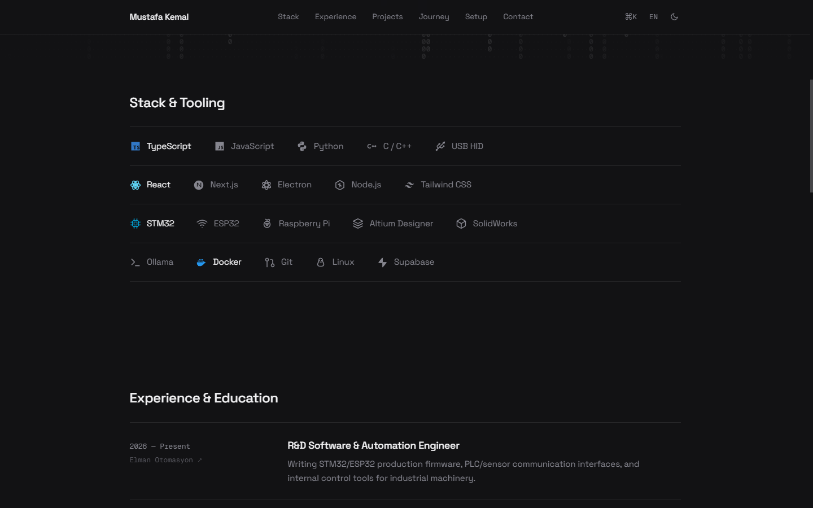
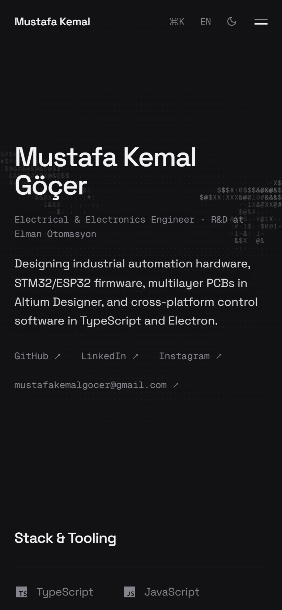
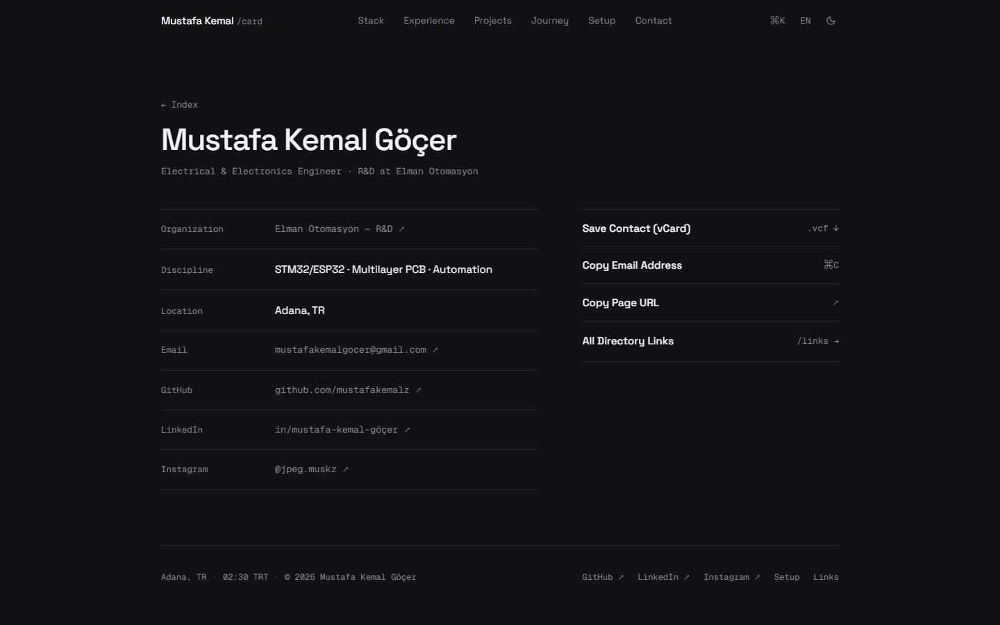
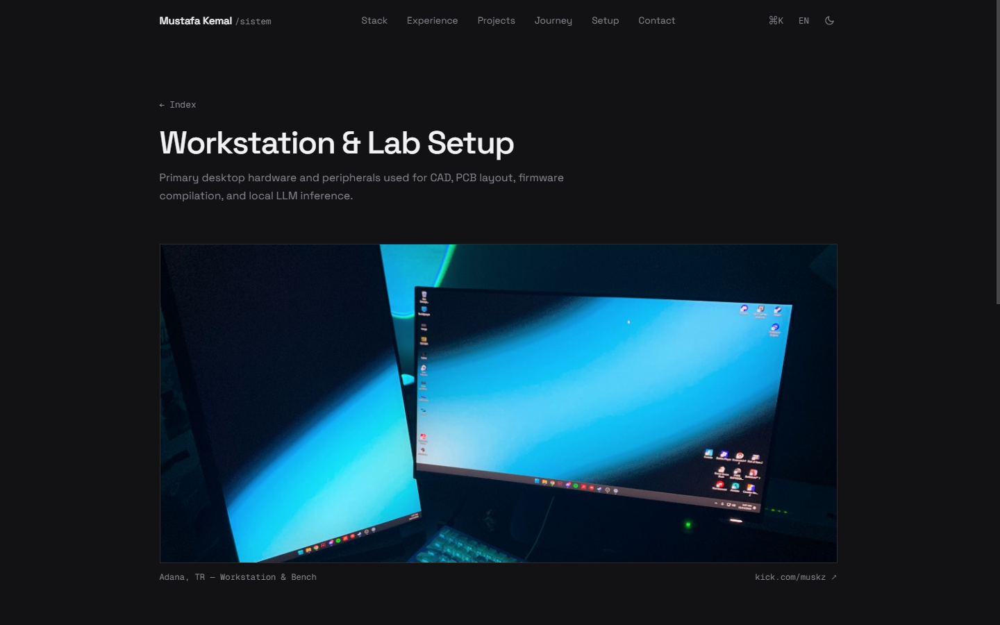

<div align="center">

```text
 ───  MUSTAFA KEMAL GÖÇER  ───
 ELECTRICAL & ELECTRONICS ENGINEER
 [ muskz.tech · mustafakemalz.github.io ]
```

# muskz.tech — Personal Engineering Portfolio

<p align="center">
  <strong>Minimal, asymmetric editorial portfolio built with React 19, TypeScript, and an interactive ASCII canvas engine.</strong>
</p>

<p align="center">
  <a href="https://muskz.tech"></a>
  <a href="https://react.dev/"></a>
  <a href="https://www.typescriptlang.org/"></a>
  <a href="https://vitejs.dev/"></a>
</p>

<p align="center">
  <a href="https://muskz.tech">🌐 Live Demo</a> ·
  <a href="#-previews">Visual Showcase</a> ·
  <a href="#-design-philosophy">Design Philosophy</a> ·
  <a href="#-architecture--stack">Architecture</a> ·
  <a href="#-pages--routes">Pages</a> ·
  <a href="#-performance">Performance</a> ·
  <a href="#-getting-started">Getting Started</a>
</p>

<br />

<a href="https://muskz.tech">
  
</a>

</div>

<br />

---

## 📸 Visual Showcase

### 1. Interactive ASCII Hero Canvas
The hero features a custom 2D Canvas engine rendering Michelangelo's *Creation of Adam* hands in live ASCII typography. The hands respond dynamically to mouse/touch gestures, disperse on scroll, and use line-level text bounding boxes (`Range.getClientRects()`) to feather brightness behind foreground text.

<div align="center">
  
</div>

<br />

### 2. Hover-Reactive Tech Stack Ledger
Instead of generic rounded pills or tag badges, technologies sit on 1px hairline rows. Muted monochrome by default, each item lights up with its authentic brand color on hover.

<div align="center">
  
</div>

<br />

### 3. Responsive Mobile & Digital vCard Specification
Seamless mobile experience (`390×844`) with borderless header controls (`⌘K`, `EN/TR`, Theme Toggle) paired with a minimalist digital specification card on `/card` supporting `.vcf` contact downloads.

<div align="center">
  <table>
    <tr>
      <td width="40%" align="center">
        <strong>Mobile Interface</strong><br /><br />
        
      </td>
      <td width="60%" align="center">
        <strong>Digital vCard Specification Ledger (/card)</strong><br /><br />
        
      </td>
    </tr>
  </table>
</div>

<br />

### 4. Hardware Workstation & Lab Bench (`/sistem`)
Dedicated technical documentation of primary development workstation hardware and lab peripherals used for PCB routing, CAD modeling, and embedded firmware compilation.

<div align="center">
  
</div>

---

## ✦ Design Philosophy

Designed to reject generic AI-slop portfolio clichés, bubble badges, and centered card grids in favor of a quiet, high-density engineering editorial aesthetic:

- **Asymmetric Hairline Ledgers**: 1px subtle hairline dividers (`rgba(255, 255, 255, 0.085)`) separating chronological records and specs instead of heavy card shadows and nested containers.
- **Interactive ASCII Canvas Engine**: A custom HTML5 Canvas rendering of Michelangelo's *Creation of Adam* hands in ASCII glyphs, featuring real-time pointer physics, scroll-driven convergence/dispersion, offscreen dot-matrix caching, and line-level typography masking.
- **Hover-Reactive Tech Ledger**: 20 authentic brand icons rendered in muted monochrome by default, smoothly lighting up in their native brand hex colors on hover.
- **Strictly Controlled Typography**: Powered exclusively by **Space Grotesk** for headings/leads and **Geist Mono** for metadata and tabular data, constrained to just 400 and 500 weights.
- **Keyboard-First Navigation**: Global Command Palette (`⌘K` / `Ctrl+K`) for instant keyboard jumps between sections, pages, language switching, and contact copying.
- **Zero Bloat**: No FontAwesome CDN, no bulky UI component libraries, no CSS frameworks. Pure handcrafted modern CSS with CSS custom properties.

---

## ⚡ Architecture & Stack

| Layer | Technologies |
| :--- | :--- |
| **Framework & Core** | [React 19](https://react.dev/), [TypeScript 5.7](https://www.typescriptlang.org/), [Vite 6](https://vitejs.dev/) |
| **Routing** | [React Router 7](https://reactrouter.com/) |
| **Smooth Scrolling** | [Lenis 1.1](https://github.com/darkroomengineering/lenis) |
| **Graphics & ASCII Engine** | Canvas 2D API, Offscreen pre-rendering, Spatial Text Masking via `Range.getClientRects()` |
| **Typography** | [Space Grotesk](https://fonts.google.com/specimen/Space+Grotesk) & [Geist Mono](https://fonts.google.com/specimen/Geist+Mono) |
| **Icons & Assets** | Zero-dependency inline SVG icon system (`Icon.tsx`), optimized webp imagery |
| **Internationalization** | Zero-overhead lightweight context (`LanguageContext.tsx` supporting TR / EN) |

---

## 📂 Project Structure

```text
mustafakemalz.github.io/
├── .github/
│   └── assets/               # Showcase screenshots used in documentation
├── public/
│   └── assets/               # Compressed WebP assets & favicon (3.4 KB)
├── src/
│   ├── components/
│   │   ├── AsciiHeroCanvas.tsx # Interactive Creation of Adam ASCII engine
│   │   ├── asciiHandsData.ts   # Base64 binary raster mask data for hands
│   │   ├── CommandMenu.tsx     # ⌘K / Ctrl+K fuzzy command palette
│   │   ├── Icon.tsx            # Zero-dependency SVG icon registry
│   │   ├── Layout.tsx          # Sticky hairline header, nav & footer
│   │   └── ProjectCard.tsx     # Hairline ledger project row component
│   ├── context/
│   │   ├── LanguageContext.tsx # EN/TR translation strings & provider
│   │   └── ThemeContext.tsx    # Light / Dark theme toggler
│   ├── pages/
│   │   ├── Home.tsx            # Main landing (Hero, Stack, Experience, Work, Activity, Notes, Contact)
│   │   ├── Sistem.tsx          # Workstation hardware specs & lab bench setup
│   │   ├── Journey.tsx         # Chronological milestones timeline
│   │   ├── LinkHub.tsx         # Clean directory of links & socials
│   │   ├── DigitalCard.tsx     # Technical vCard & contact specification ledger
│   │   └── NotFound.tsx        # 404 handler with canvas noise effect
│   ├── index.css               # Editorial styles, design tokens & dark/light themes
│   ├── App.tsx                 # Route declarations & Lenis initialization
│   └── main.tsx                # React root bootstrap
├── index.html                  # SEO, JSON-LD schema & font preconnections
└── package.json
```

---

## 🗺 Pages & Routes

- **`/` (Index)**: Left-aligned editorial hero with ASCII canvas, 4-row hover-colored tech ledger, 2-column experience ledger, featured projects ledger, live Spotify/GitHub status, lab notes gallery, and contact form.
- **`/sistem`**: Detailed specifications of development workstation (Ryzen 7, RX 7700 XT, dual monitors, custom mechanical peripherals) and lab equipment.
- **`/journey`**: Minimalist chronological timeline spanning hardware experiments to production R&D engineering.
- **`/links`**: Clean, unboxed directory for direct navigation to profiles (GitHub, LinkedIn, Instagram, Kick, etc.).
- **`/card`**: Digital specification card with one-click `.vcf` contact download, direct clipboard copying, and directory routing.
- **`/404`**: Flush-left 404 screen featuring a canvas fuzz noise animation.

---

## 📊 Performance & Optimization

Benchmark results measured via headless Chromium CDP:

- **Network Payload**: Transferred bundle reduced by **~43%** (from 1.83 MB down to 1.03 MB).
- **CSS Footprint**: Entire application stylesheet is only **26 KB** (~4.9 KB gzipped).
- **Font & Icon Optimization**: 272 KB FontAwesome CDN completely eliminated; icons rendered inline as scalable SVGs.
- **CPU & Main Thread**: Idle background rendering reduced from **76.5% down to 8.1%** via:
  - Offscreen dot-matrix caching (avoiding 12,000+ per-frame `fillRect` calls).
  - 7-level luminance batching (grouping characters to eliminate thousands of `ctx.fillStyle` switches).
  - Adaptive frame throttling (15ms during interactions, 64ms calm breathing during idle).

---

## 🛠 Getting Started

### Prerequisites
- Node.js (v18.0.0 or later)
- npm or pnpm

### Installation

```bash
# Clone the repository
git clone https://github.com/mustafakemalz/mustafakemalz.github.io.git
cd mustafakemalz.github.io

# Install dependencies
npm install

# Start local development server
npm run dev
```

### Production Build

```bash
# Type-check and build production bundle
npm run build

# Preview production build locally
npm run preview
```

---

## 👤 Author

**Mustafa Kemal Göçer**
- Website: [muskz.tech](https://muskz.tech)
- GitHub: [@mustafakemalz](https://github.com/mustafakemalz)
- LinkedIn: [mustafa-kemal-göçer](https://tr.linkedin.com/in/mustafa-kemal-g%C3%B6%C3%A7er-41409b255)
- Instagram: [@jpeg.muskz](https://www.instagram.com/jpeg.muskz/)
- Email: [mustafakemalgocer@gmail.com](mailto:mustafakemalgocer@gmail.com)

---

<div align="center">
  <sub>Built with care, precision, and zero template fluff.</sub>
</div>
